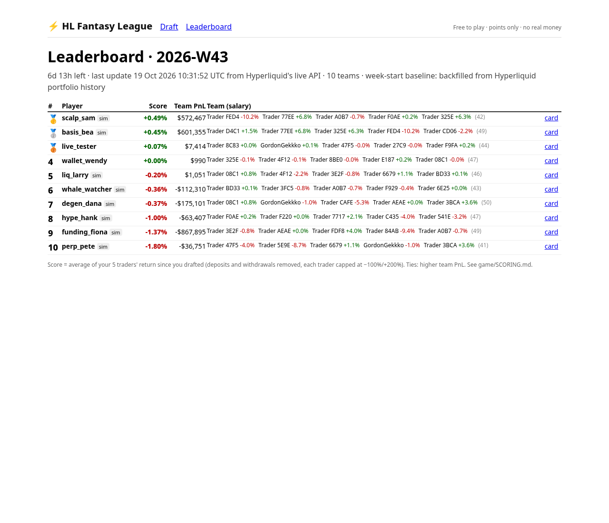

# HL Fantasy League (MVP)

Draft 5 real Hyperliquid traders each week. Your score is how those traders *actually* do on Hyperliquid,
read live from Hyperliquid's public API. Free to play, points only: **no real money, no prizes, no keys.**

- Concept and competitors: [RESEARCH.md](RESEARCH.md)
- How the score works: [SCORING.md](SCORING.md)



## How a week works
1. **Monday 00:00 UTC**: a new week starts. The pool is ~50 verified traders (public leaderboard → our wallet checker).
   Each has a salary of 5–15 credits based on the last 30 days. You get 50 credits for 5 picks, so the five hottest traders don't fit.
2. **Draft** at `/game`: pick 5, choose a username (or also connect a wallet and sign one message to prove it's you; no transaction). Lock in.
3. **Live score**: from the moment you lock in, your team's score = the average return of your 5 traders (deposits/withdrawals removed).
   The scoring job refreshes every 10 minutes; `/game/leaderboard` reloads every minute.
4. **Brag**: every team has a page `/game/p/<username>` with a result card image that X shows when you share the link.
5. **Next Monday** the week is frozen and a new one starts.

## Run it (beginner steps)
You need Node.js 20+ (`node -v`). All commands are from `market/` (this folder is `market/game`).

```bash
# 0) one-time: install the web app (the game engine itself has no dependencies)
cd web && npm install && cd ..

# 1) build this week's pool of ~50 verified traders (takes ~5 min; it calls Hyperliquid's API one wallet at a time)
cd game && node scripts/build-pool.js

# 2) start the week (snapshot) and take a first live reading
node scripts/snapshot.js

# 3) optional, for a demo: add 8 fake players (marked "sim")
node scripts/simulate-players.js

# 4) keep scores fresh (every 10 minutes); leave this running in its own terminal
node scripts/update-scores.js --watch 10

# 5) in another terminal: run the website
cd ../web && npm run build && npm start      # or: npm run dev
```
Open http://localhost:3000/game (draft), http://localhost:3000/game/leaderboard, and http://localhost:3000/game/p/degen_dana (a share page).

Every Monday: run `node scripts/build-pool.js` (new pool and salaries) and `node scripts/snapshot.js` as close to 00:00 UTC as you can.
If you miss it, the start of the week is backfilled from Hyperliquid's history (slightly less precise; the leaderboard says so).
For the share cards to work on X, the site must be public and `GAME_PUBLIC_URL` set to its address (e.g. `GAME_PUBLIC_URL=https://yourdomain npm start`).

Tests: `cd game && npm test` (offline, fake API). The older agent tests: `cd agents && npm test`.

## Where things are
| Path | What |
|---|---|
| `game/lib/hl.js` | Reads a trader from Hyperliquid's `portfolio` endpoint; the per-trader return formula |
| `game/lib/league.js` | Weeks, baselines, entries, snapshots, leaderboard |
| `game/lib/salary.js` | Salaries and the cap |
| `game/lib/store.js` | JSON files in `game/data/` (`pool.json`, `league.json`) with a lock |
| `game/scripts/*.js` | build-pool, snapshot, update-scores, simulate-players, screenshot |
| `web/app/game/*` | Draft page, leaderboard, share page, result-card image (`/game/card/<username>`) |
| `web/app/api/game/*` | `pool`, `enter`, `leaderboard` JSON endpoints |

Reused from the existing MVP: `agents/feed-hl.js` (candidate wallets from the public leaderboard) and
`agents/walletRules.js` (the checker and its API helper). Neither file was changed.

## How this makes money later (not built; needs legal advice first)
Free-to-play first, to prove people come back every week. Options, roughly from safest to most regulated:
1. **Sponsors and partner leagues**: a Hyperliquid builder-code app, a vault, or a project sponsors a week ("the X League"). Sponsors pay us; players still play free. Prizes are paid by the sponsor as a free-entry promotion, under sweepstakes rules (free entry, no purchase needed, terms per country).
2. **Copy/follow funnel**: "your team made +8% this week: follow these traders" → link to a copy-trading app or vault with a referral, or our own builder-code copy flow (HyperDash charges a 0.05% builder fee on copied trades, per its docs).
3. **Premium tools (no effect on winning odds)**: deeper trader stats, alerts when your drafted traders open positions, private leagues for communities or Discords, team history. A subscription.
4. **Data/API**: the verified pool and weekly "trader form" data, sold to apps and agents (fits the existing Spendlock verified-wallets product).
5. **Paid entry with prizes (daily-fantasy style)**: the biggest upside, and gambling or skill-gaming regulation in most places. It needs a licence or a legal opinion for each market, age and location checks, KYC, and responsible-gaming tools. Don't do this without a lawyer.

Never reward people for posting on X (X cut off Kaito's Yaps for that; see RESEARCH.md). Share cards are bragging only.

## Limits of this MVP
- JSON files, one machine. Move to SQLite/Postgres before real traffic.
- A username alone isn't protected: anyone can take an unused name. Connecting a wallet locks the name to that wallet for future weeks.
- The share card needs a public URL to show up on X.
- Backfilled week starts can be off by up to ~2.5 hours (the spacing of Hyperliquid's history points).
- Wallets at Hyperliquid's 10,000-fill history cap are allowed (marked "very active"); their 30-day trade count and realized PnL are lower bounds. The score doesn't use fills.
- No opt-out list for traders yet, and no anti-collusion checks (only needed before any prizes).
